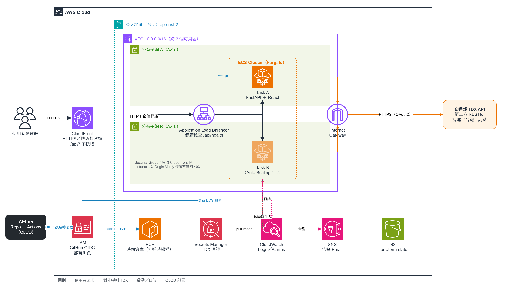

# HackRail 轉乘通 — Cross-Transport Transfer Platform

[](https://github.com/lhy4290/HackRail-TransferPlatform/actions/workflows/deploy.yml)

## 雲端部署（國泰金控雲端技術暨專案實習生 實作測驗）

**線上網址**：https://d1woox6ec5bt9l.cloudfront.net　（AWS 台北區域，真實 TDX 資料）



| 題目要求 | 對應成果 |
|---|---|
| 雲端後端架構（Python） | FastAPI 容器部署於 AWS ECS Fargate，前面接 ALB 與 CloudFront |
| 雲端架構圖 | 上圖；原始檔 [`docs/architecture.drawio`](docs/architecture.drawio) |
| 程式用途、功能、服務選用原因 | [docs/cloud-architecture.md](docs/cloud-architecture.md) 第 1、2、4 節 |
| 加分：前端程式 | React + TypeScript + Vite（[`frontend/`](frontend/)） |
| 加分：串接第三方 RESTful API | 交通部 TDX API，OAuth2（[`backend/app/adapters/`](backend/app/adapters/)） |
| 加分：CI/CD | GitHub Actions：PR 跑測試與掃描，merge 後經 OIDC 自動部署（[`.github/workflows/`](.github/workflows/)） |
| 加分：Git 協作流程 | GitHub Flow ＋ 分支保護（架構文件第 6 節） |
| 加分：IaC | Terraform 建置全部 AWS 資源（[`infra/`](infra/)，部署手冊 [infra/README.md](infra/README.md)） |
| 加分：AI 輔助開發心得 | 架構文件第 9 節 |

完整說明（架構、安全設計、設計取捨、成本、實際遇到的問題）：**[docs/cloud-architecture.md](docs/cloud-architecture.md)**

---

A cross-transport transfer information platform built for the HackRail hackathon, unifying Taiwan's fragmented rail systems — Metro (Taoyuan/Taichung/Kaohsiung), TRA, and THSR — into a single trip-planning experience. Enter an origin and destination, and the platform integrates real-time arrival/departure data across operators, automatically plans the best multi-modal transfer route, and predicts transfer risk from historical delay data so travelers know which connections to worry about.

## Features

- **Cross-transport route search** — Time-Dependent Dijkstra plus a custom Yen's k-shortest-paths implementation returns 1–5 routes within 5 seconds, sorted by total trip time, guaranteeing at least one route spans 2+ transport modes.
- **Transfer station details** — walking distance and time between connecting platforms, with buffer time factored into total transfer time (defaults applied with a visible notice when data is missing).
- **Live arrival/departure board** — polls each operator's live board every 60s, showing early/on-time/delayed status versus scheduled times, and flags connections where the buffer time is at risk.
- **Transfer risk prediction** — classifies each connection as On-Time / Minor Delay / Severe Delay based on station, transport-mode combination, and peak/off-peak timing, and surfaces a low-risk alternative route when a connection is flagged severe.
- **Route map visualization** — Leaflet.js map with distinct colors per transport mode and transfer station markers, responsive across devices.
- **Service alert integration** — surfaces TDX operational alerts on affected routes and proactively suggests alternatives when an alert threatens a connection.

## Architecture

Four-layer design: **Data → Integration → Application Logic → Presentation**


Adding a new transport mode only requires a new adapter subclass + `FieldSpec` — no changes to existing adapter logic.

## Getting Started

### Prerequisites

- Python 3.11+
- Node.js 18+
- (Optional) TDX API credentials — [register here](https://tdx.transportdata.tw/) — only needed for live data; see **Demo Mode** below to run without any credentials.

### Backend

```powershell
cd backend
python -m venv .venv
.\.venv\Scripts\python.exe -m pip install -e ".[dev]"

# Optional: enable live TDX data
# create backend/.env with:
#   TDX_CLIENT_ID=your_client_id
#   TDX_CLIENT_SECRET=your_client_secret

.\.venv\Scripts\python.exe -m uvicorn app.main:app --reload --port 8000
