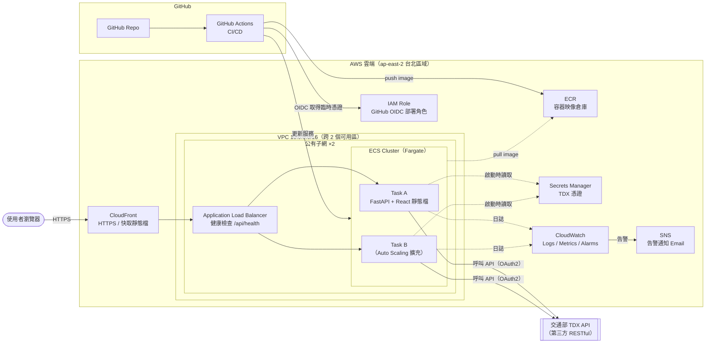
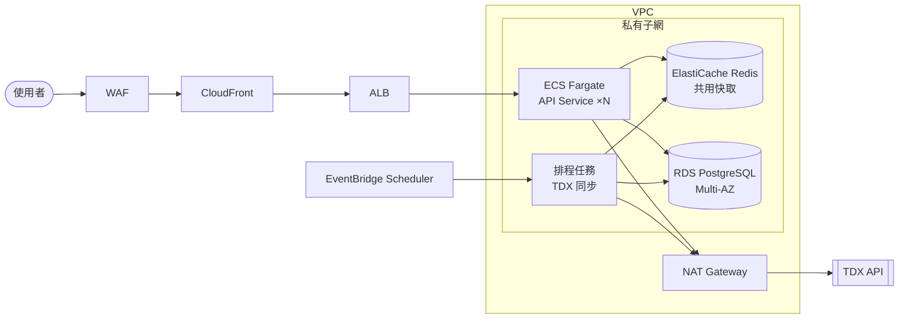
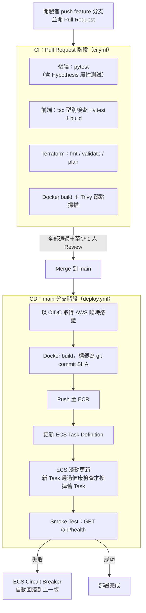
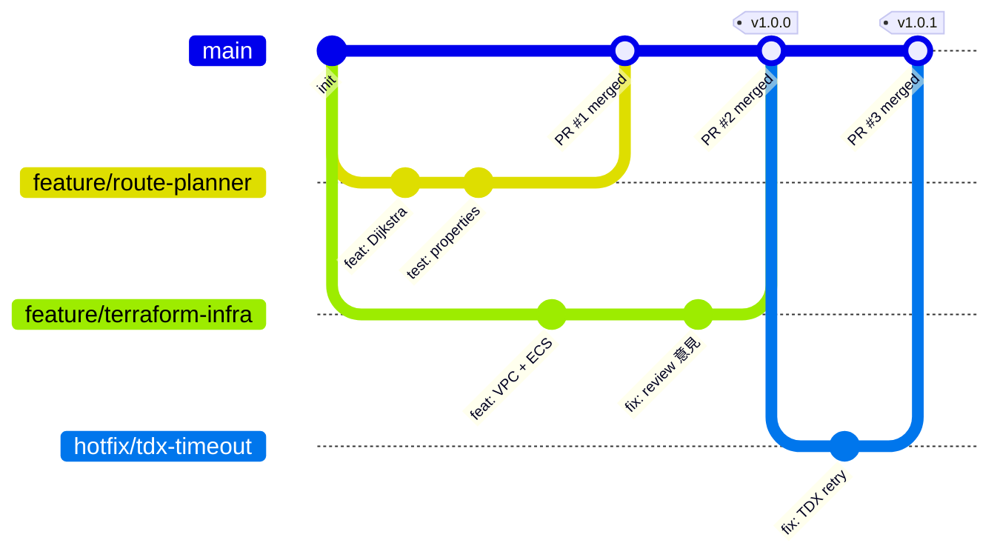

# 轉乘通 HackRail — 雲端後端架構設計

> 國泰金控「雲端技術暨專案實習生」面試前實作測驗
> 程式語言：Python（FastAPI）＋ TypeScript（React）｜雲端平台：AWS｜IaC：Terraform｜CI/CD：GitHub Actions

---

## 0. 題目要求對照表

| 題目要求 | 本專案的對應成果 | 位置 |
|---|---|---|
| 雲端後端架構（放置 Java / Python 程式） | FastAPI 後端容器化，部署於 AWS ECS Fargate | `backend/`、`Dockerfile` |
| 雲端架構圖 | 第 3 節架構圖（另匯出 PNG） | `docs/images/architecture.png` |
| 程式用途、主要功能、服務選用原因 | 第 1、2、4 節 | 本文件 |
| 加分 1：前端程式 | React + TypeScript + Vite 單頁應用，含地圖 | `frontend/` |
| 加分 2：串接第三方 RESTful API | 交通部 TDX API（OAuth2，捷運／台鐵／高鐵） | `backend/app/adapters/` |
| 加分 3：CI/CD 架構或流程圖 | GitHub Actions：測試 → 建置 → 推送 ECR → 部署 ECS | 第 5 節、`.github/workflows/` |
| 加分 4：多人協作 Git 工作流程圖 | GitHub Flow ＋ 分支保護 ＋ PR 審查 | 第 6 節 |
| 加分 5：IaC 建置雲端架構 | Terraform 模組化建置所有 AWS 資源 | 第 7 節、`infra/terraform/` |
| 加分 6：AI 輔助開發與心得 | Kiro（規格驅動）＋ Claude Code（實作與測試） | 第 8 節 |

---

## 1. 程式用途

**轉乘通**是一個跨運具轉乘規劃平台。使用者輸入起訖站，系統整合捷運（桃園、高雄、台中）、台鐵、高鐵的即時資料，規劃 1–5 條轉乘路線，並預測每條路線的延誤風險。

要解決的問題：現有 App 多半只查單一運具，跨運具轉乘（例如「高鐵左營 → 高雄捷運」）要自己切換多個 App 比對時刻與轉乘步行時間。

## 2. 主要功能

| 功能 | API | 說明 |
|---|---|---|
| 跨運具路線規劃 | `POST /api/routes/search` | Time-Dependent Dijkstra ＋ Yen's K 最短路徑，回傳 1–5 條路線，保證至少一條跨運具 |
| 延誤風險預測 | （含在路線結果中） | 依尖峰／離峰歷史平均延誤估算每段風險等級 |
| 車站自動完成 | `GET /api/stations/suggest` | 輸入 2 字以上即提示，500ms 內回應 |
| 即時看板 | `GET /api/liveboard/{station_id}` | 即時列車到站資訊，前端每 60 秒輪詢 |
| 營運異常通報 | `GET /api/alerts` | 整合營運商異常公告，TDX 故障時保留最後資料 10 分鐘 |
| 轉乘資訊 | `GET /api/transfers/{transfer_id}` | 轉乘站步行時間與動線 |
| 健康檢查／指標 | `GET /api/health`、`GET /api/metrics` | 供負載平衡器健康檢查與監控使用 |

---

## 3. 雲端架構圖



> 繳交時另用 draw.io（AWS 官方圖示庫）畫一張正式版，匯出成 `docs/images/architecture.png`；Mermaid 版保留在文件中，GitHub 會直接顯示。

### 請求流程

1. 使用者透過 HTTPS 連到 **CloudFront**，前端靜態檔由 CloudFront 快取。
2. `/api/*` 的請求轉給 **ALB**，ALB 依健康檢查結果分配到正常的 **Fargate Task**。
3. Task 內的 FastAPI 呼叫 **TDX API** 取得資料，先查記憶體快取（靜態資料、即時資料、異常公告各有不同 TTL），沒有命中才打 TDX。
4. TDX 憑證在 Task 啟動時由 ECS 從 **Secrets Manager** 注入成環境變數，程式碼與映像檔裡都沒有密鑰。
5. 所有日誌送到 **CloudWatch Logs**；錯誤率或健康檢查異常時，**CloudWatch Alarm** 透過 **SNS** 寄 Email 通知。

---

## 4. 雲端服務選用原因

| 服務 | 用途 | 為什麼選它 | 考慮過的替代方案 |
|---|---|---|---|
| **ECS Fargate** | 執行後端容器 | 專案已有 Dockerfile，容器化可確保本機與雲端環境一致；Fargate 不需管理 EC2 主機（不用自己更新 OS、打補丁） | **EC2**：要自己維運主機。**Lambda**：本服務有背景排程（SyncScheduler 定期同步 TDX）和記憶體快取，不適合無狀態、會冷啟動的 Lambda。**EKS**：功能強但對單一服務來說太複雜，控制平面每月固定約 USD 73 |
| **ALB** | 負載平衡、健康檢查 | 依 `/api/health` 自動剔除異常 Task；搭配 ECS 做滾動更新，部署不停機 | NLB：第 4 層，不支援 HTTP 路徑層級的健康檢查 |
| **CloudFront** | HTTPS 入口、CDN | 不需購買網域就有預設 HTTPS 憑證；靜態檔就近快取；可再掛 AWS WAF 擋惡意流量 | 直接開 ALB：需要自有網域與 ACM 憑證才有 HTTPS |
| **ECR** | 存放容器映像 | 與 ECS、IAM 整合，推送時可自動弱點掃描 | Docker Hub：公開倉庫有外洩疑慮，且有拉取次數限制 |
| **Secrets Manager** | 存放 TDX 憑證 | 密鑰不進 Git、不進映像；以 IAM 控管誰能讀取，存取紀錄可在 CloudTrail 稽核 | SSM Parameter Store：較便宜，但沒有自動輪替功能 |
| **CloudWatch ＋ SNS** | 日誌、監控、告警 | AWS 原生，ECS 設定後日誌自動送入，不必另架監控系統 | Prometheus ＋ Grafana：要自己架設與維運 |
| **IAM ＋ GitHub OIDC** | CI/CD 部署權限 | GitHub Actions 每次部署取得**臨時憑證**，不必把長期 Access Key 存在 GitHub；部署角色只給 ECR 推送與 ECS 更新的最小權限 | 長期 Access Key：外洩風險高，金融業資安稽核通常不允許 |
| **ap-east-2（台北）區域** | 部署區域 | 使用者都在台灣，延遲最低；資料留在國內，符合金融業對資料落地的要求 | ap-northeast-1（東京）：服務最齊全，可當備援 |

### 安全性設計（對應金融業要求）

- **網路隔離**：Fargate Task 的 Security Group 只允許來自 ALB 的流量，外部無法直接連線到容器。
- **最小權限**：分成兩個 IAM 角色。Task Execution Role 只能拉映像和讀取指定的 Secret；GitHub 部署角色只能推送 ECR 和更新指定的 ECS 服務。
- **密鑰管理**：所有憑證放在 Secrets Manager，repo 內只有 `.env.example`。
- **映像安全**：ECR 開啟推送時掃描，CI 也用 Trivy 掃描，有 Critical 弱點就中止部署。
- **可稽核**：CloudTrail 記錄所有 API 操作，CloudWatch Logs 保留 30 天。

### 設計取捨（面試時可主動說明）

| 取捨 | 目前作法 | 理由 | 正式上線時的調整 |
|---|---|---|---|
| Task 放公有子網 | Task 有公有 IP，但 Security Group 只開放 ALB 進入 | 省下 NAT Gateway（每月約 USD 35 以上），Task 仍能連到外部的 TDX API | 改放私有子網＋ NAT Gateway，Task 完全不對外 |
| 資料庫用 SQLite | 沿用容器內的 SQLite | 存的資料（API 呼叫紀錄、TDX 同步資料）都能從 TDX 重建，遺失也不影響服務 | 改用 RDS PostgreSQL（Multi-AZ）放私有子網 |
| 記憶體快取 | 每個 Task 各自快取 | 實作簡單，單一 Task 就夠用 | 擴充到多個 Task 時，各 Task 會重複呼叫 TDX，可能觸發 TDX 的頻率限制。改用 ElastiCache Redis 共用快取，並把 SyncScheduler 拆成獨立的排程任務（EventBridge Scheduler） |
| Auto Scaling 上限 | 最少 1、最多 2 個 Task，CPU 超過 60% 擴充 | 控制成本，同時展示擴充機制 | 依壓力測試（Locust）結果調整 |

### 未來演進架構



### 成本估算（每月，以 1 個 Task 常駐估算）

| 項目 | 規格 | 約略費用（USD） |
|---|---|---|
| ECS Fargate | 0.5 vCPU／1 GB，24 小時 | ~18 |
| ALB | 1 個，低流量 | ~18 |
| CloudFront | 低流量（免費額度內） | ~0 |
| ECR | < 1 GB | ~0.1 |
| Secrets Manager | 1 個 Secret | ~0.4 |
| CloudWatch | 少量日誌 | ~1 |
| **合計** | | **約 USD 38／月** |

> 費用為估計值，實際以 AWS Pricing Calculator 為準。面試結束後執行 `terraform destroy` 一鍵刪除所有資源，避免持續計費。

---

## 5. CI/CD 流程



設計重點：

- **映像標籤用 commit SHA，不用 `latest`**：每個版本都能追溯到對應的程式碼，回滾時直接指定舊 SHA。
- **部署不停機**：ECS 滾動更新搭配 ALB 健康檢查，新版本健康才切換流量。
- **自動回滾**：開啟 ECS Deployment Circuit Breaker，新版本一直起不來就自動退回上一版。
- **基礎架構變更也要 Review**：PR 上自動跑 `terraform plan` 並把結果貼到 PR 留言，審查者看得到這次會新增或刪除哪些資源。

---

## 6. 多人協作 Git 工作流程

採用 **GitHub Flow**：`main` 永遠是可部署的狀態，所有變更都從 feature 分支開 PR 合併。



| 規範 | 內容 |
|---|---|
| 分支命名 | `feature/*` 新功能、`fix/*` 一般修正、`hotfix/*` 緊急修正、`docs/*` 文件 |
| Commit 訊息 | Conventional Commits：`feat:`、`fix:`、`docs:`、`test:`、`chore:` |
| `main` 分支保護 | 禁止直接 push；PR 必須 CI 全部通過且至少 1 人 Approve 才能合併 |
| 合併方式 | Squash merge，讓 `main` 的歷史一個 PR 一個 commit |
| 版本 | 上線版本打 Git tag（`v1.0.0`，語意化版本） |
| 程式碼擁有者 | `CODEOWNERS` 指定 `infra/` 變更必須由負責雲端的成員審查 |

選擇 GitHub Flow 而非 Git Flow 的原因：本專案搭配 CI/CD 持續部署，不需要 `develop`、`release` 等長期分支；分支越少，合併衝突越少，適合小團隊快速迭代。

---

## 7. Infrastructure as Code（Terraform）

### 目錄結構

```
infra/terraform/
├── main.tf              # provider、後端狀態設定
├── variables.tf         # 區域、映像標籤、Task 規格等參數
├── outputs.tf           # 輸出 CloudFront 網址、ECR 位址
├── network.tf           # VPC、2 個公有子網、Internet Gateway、Security Groups
├── ecr.tf               # 映像倉庫（推送時掃描、保留最近 10 版）
├── ecs.tf               # Cluster、Task Definition、Service、Auto Scaling
├── alb.tf               # ALB、Target Group（健康檢查 /api/health）、Listener
├── cloudfront.tf        # CloudFront Distribution（/api/* 不快取）
├── secrets.tf           # Secrets Manager（只建立空殼，值由人工填入）
├── iam.tf               # Task Execution Role、GitHub OIDC 部署角色
└── monitoring.tf        # CloudWatch Log Group、Alarms、SNS Topic
```

### 為什麼選 Terraform

- **宣告式**：描述「想要的最終狀態」，Terraform 自動算出要新增、修改、刪除什麼。
- **可審查**：基礎架構和程式碼一樣走 PR 流程，`terraform plan` 讓每次變更都看得到。
- **可重現**：一行 `terraform apply` 就能在新帳號或新區域建出同一套環境；`terraform destroy` 一鍵刪除。
- **跨雲**：同一套工具也能管 Azure、GCP，業界普及度高。（AWS CDK 也是選項，但只限 AWS。）

### 狀態管理

Terraform state 存在 S3（開啟版本控制與加密），並用 S3 原生鎖定防止多人同時 apply 互相覆蓋。

### 部署指令

```bash
cd infra/terraform
terraform init
terraform plan -out=tfplan
terraform apply tfplan
# 在 AWS Console 或用 CLI 將 TDX 憑證填入 Secrets Manager
aws secretsmanager put-secret-value --secret-id hackrail/tdx --secret-string '{"TDX_CLIENT_ID":"...","TDX_CLIENT_SECRET":"..."}'
```

---

## 8. AI 輔助開發工具使用說明與心得

| 工具 | 使用階段 | 使用方式 |
|---|---|---|
| **Kiro** | 需求與設計 | 規格驅動開發：先產生 `requirements.md`（需求與驗收條件）、`design.md`（四層架構與 21 條正確性屬性）、`tasks.md`（14 項實作任務），再依任務逐項實作。規格存放在 `.kiro/specs/` |
| **Claude Code** | 實作、測試、雲端建置 | 依規格實作後端 Adapter、路線演算法與前端元件；撰寫 pytest ＋ Hypothesis 屬性測試；產生 Terraform 與 GitHub Actions 設定，並逐一檢查每個資源與權限 |

### 心得（草稿，請改成你自己的經驗）

> 以下是撰寫方向。只寫你真的遇到過的事，面試時會被追問。

1. **先寫規格再寫程式，AI 的輸出比較穩定**：有明確的需求與驗收條件，AI 產生的程式碼比較不會偏離目標，也比較好檢查。
2. **用測試驗證 AI 的程式碼**：例如路線規劃演算法，用 Hypothesis 屬性測試驗證「回傳路線依時間排序」「至少一條跨運具」等條件，不只看程式碼「看起來對」。
3. **AI 不知道外部 API 的真實狀況**：TDX 台鐵、高鐵的 AlertInfo 端點實際呼叫會回 404，只有實際打真實 API 才發現，目前只有捷運的異常通報確認可用。
4. **雲端設定要逐行看懂**：（實作 Terraform 時補上）檢查 AI 產生的 IAM Policy 權限範圍是否過寬（例如 `"Resource": "*"`），有的話記錄你怎麼縮小權限。

---

## 9. 本機執行

```bash
# 不需任何憑證：未設定 TDX 憑證時自動進入 Demo 模式，使用內建快照資料
docker build -t hackrail .
docker run -p 8000:8000 hackrail
# 開啟 http://localhost:8000
```
