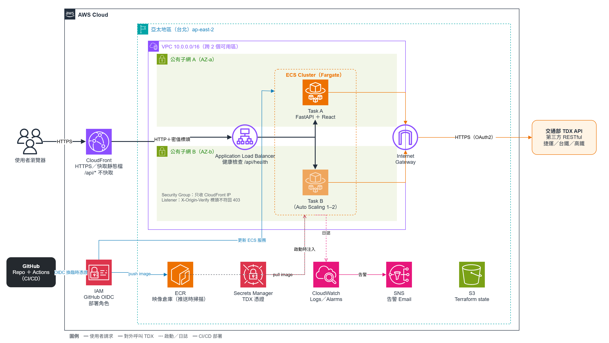
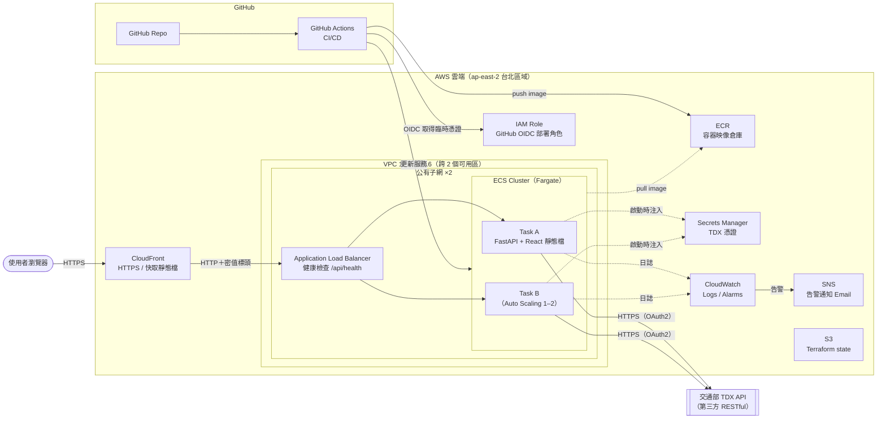
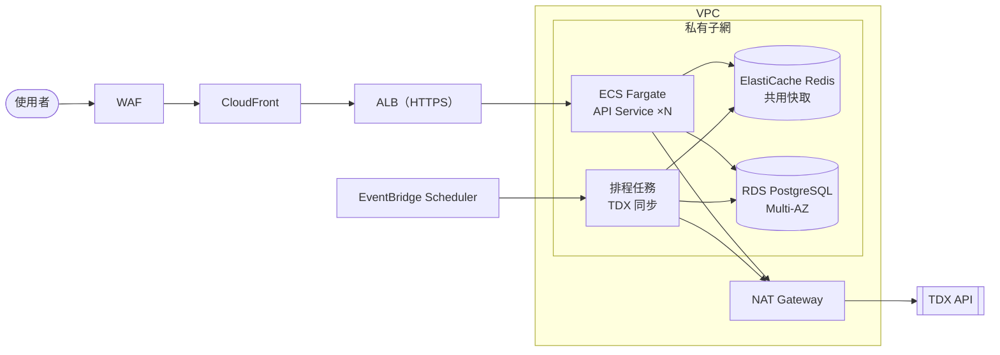
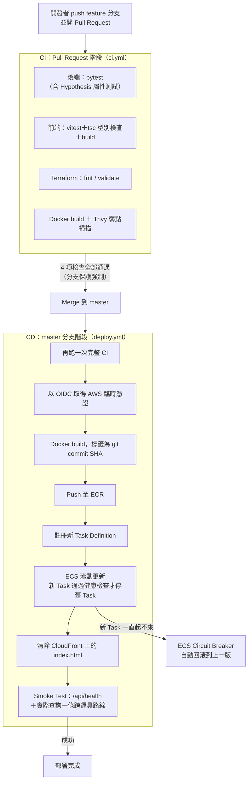
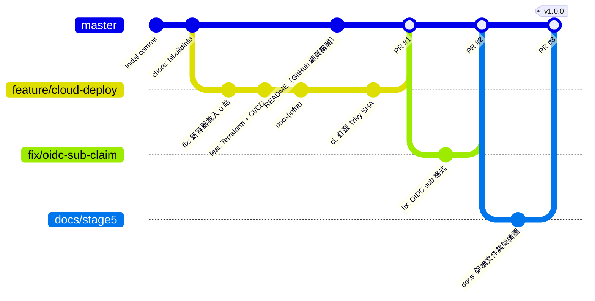

# 轉乘通 HackRail — 雲端後端架構設計

> 國泰金控「雲端技術暨專案實習生」面試前實作測驗
> 程式語言：Python（FastAPI）＋ TypeScript（React）｜雲端平台：AWS｜IaC：Terraform｜CI/CD：GitHub Actions

**線上網址**：https://d1woox6ec5bt9l.cloudfront.net
**部署手冊**：[infra/README.md](../infra/README.md)

---

## 0. 題目要求對照表

| 題目要求 | 本專案的對應成果 | 位置 |
|---|---|---|
| 雲端後端架構（放置 Java / Python 程式） | FastAPI 後端容器化，部署於 AWS ECS Fargate（台北區域），已上線 | `backend/`、`Dockerfile` |
| 雲端架構圖 | 第 3 節架構圖；正式版（AWS 官方圖示） | `docs/images/architecture.png`、原始檔 `docs/architecture.drawio` |
| 程式用途、主要功能、服務選用原因 | 第 1、2、4 節 | 本文件 |
| 加分 1：前端程式 | React + TypeScript + Vite 單頁應用，含地圖 | `frontend/` |
| 加分 2：串接第三方 RESTful API | 交通部 TDX API（OAuth2，捷運／台鐵／高鐵），線上環境以真實資料運作 | `backend/app/adapters/` |
| 加分 3：CI/CD 架構或流程圖 | GitHub Actions：PR 跑 CI，merge 後經 OIDC 自動部署到 ECS，已實際運作 | 第 5 節、`.github/workflows/` |
| 加分 4：多人協作 Git 工作流程圖 | GitHub Flow ＋ 分支保護（必須通過 CI）＋ PR | 第 6 節 |
| 加分 5：IaC 建置雲端架構 | Terraform 建置全部 AWS 資源（含 state bucket） | 第 7 節、`infra/` |
| 加分 6：AI 輔助開發與心得 | Kiro（規格驅動）＋ Claude Code（實作、測試、雲端建置） | 第 9 節 |

---

## 1. 程式用途

**轉乘通**是一個跨運具轉乘規劃平台。使用者輸入起訖站，系統整合捷運（桃園、高雄、台中）、台鐵、高鐵的即時資料，規劃 1–5 條轉乘路線，並預測每條路線的延誤風險。

要解決的問題：現有 App 多半只查單一運具，跨運具轉乘（例如「高鐵左營 → 高雄捷運」）要自己切換多個 App 比對時刻與轉乘步行時間。

## 2. 主要功能

| 功能 | API | 說明 |
|---|---|---|
| 跨運具路線規劃 | `POST /api/routes/search` | Time-Dependent Dijkstra ＋ Yen's K 最短路徑，回傳 1–5 條路線，保證至少一條跨運具 |
| 延誤風險預測 | （含在路線結果中） | 依尖峰／離峰歷史平均延誤估算每段風險等級 |
| 車站自動完成 | `GET /api/stations/suggest` | 輸入 2 字以上即提示，500ms 內回應 |
| 即時看板 | `GET /api/liveboard/{station_id}` | 即時列車到站資訊，前端每 60 秒輪詢 |
| 營運異常通報 | `GET /api/alerts` | 整合營運商異常公告，TDX 故障時保留最後資料 10 分鐘 |
| 轉乘資訊 | `GET /api/transfers/{transfer_id}` | 轉乘站步行時間與動線 |
| 健康檢查／指標 | `GET /api/health`、`GET /api/metrics` | 供負載平衡器健康檢查與監控使用 |

---

## 3. 雲端架構圖



> 正式版以 draw.io（AWS 官方圖示庫）繪製，原始檔為 [`docs/architecture.drawio`](architecture.drawio)。下方 Mermaid 版內容相同，GitHub 會直接顯示。



### 請求流程

1. 使用者透過 HTTPS 連到 **CloudFront**，前端靜態檔由 CloudFront 快取；HTTP 會被 301 轉到 HTTPS。
2. `/api/*` 的請求不快取，CloudFront 帶著一個只有它知道的 `X-Origin-Verify` 標頭轉給 **ALB**。
3. ALB 依健康檢查結果分配到正常的 **Fargate Task**。
4. Task 內的 FastAPI 先查記憶體快取（靜態資料、即時資料、異常公告各有不同 TTL），沒有命中才呼叫 **TDX API**。
5. TDX 憑證在 Task 啟動時由 ECS 從 **Secrets Manager** 注入成環境變數，程式碼與映像檔裡都沒有密鑰。
6. 日誌送到 **CloudWatch Logs**；5xx 過多或 Task 健康檢查失敗時，**CloudWatch Alarm** 透過 **SNS** 寄 Email。

---

## 4. 雲端服務選用原因

| 服務 | 用途 | 為什麼選它 | 考慮過的替代方案 |
|---|---|---|---|
| **ECS Fargate** | 執行後端容器 | 專案已有 Dockerfile，容器化可確保本機與雲端環境一致；Fargate 不需管理 EC2 主機（不用自己更新 OS、打補丁） | **EC2**：要自己維運主機。**Lambda**：本服務有背景排程（SyncScheduler 定期同步 TDX）和記憶體快取，不適合無狀態、會冷啟動的 Lambda。**EKS**：功能強但對單一服務來說太複雜，控制平面每月固定約 USD 73 |
| **ALB** | 負載平衡、健康檢查 | 依 `/api/health` 自動剔除異常 Task；搭配 ECS 做滾動更新，部署不停機；可依 HTTP 標頭決定是否轉送 | NLB：第 4 層，不支援 HTTP 路徑層級的健康檢查和標頭比對 |
| **CloudFront** | HTTPS 入口、CDN | 不需購買網域就有預設 HTTPS 憑證；靜態檔就近快取；可再掛 AWS WAF 擋惡意流量 | 直接開 ALB：需要自有網域與 ACM 憑證才有 HTTPS |
| **ECR** | 存放容器映像 | 與 ECS、IAM 整合，推送時自動弱點掃描；標籤設為不可變更 | Docker Hub：公開倉庫有外洩疑慮，且有拉取次數限制 |
| **Secrets Manager** | 存放 TDX 憑證 | 密鑰不進 Git、不進映像、不進 Terraform state；以 IAM 控管誰能讀取 | SSM Parameter Store：較便宜，但沒有自動輪替功能 |
| **CloudWatch ＋ SNS** | 日誌、監控、告警 | AWS 原生，ECS 設定後日誌自動送入，不必另架監控系統 | Prometheus ＋ Grafana：要自己架設與維運 |
| **IAM ＋ GitHub OIDC** | CI/CD 部署權限 | GitHub Actions 每次部署取得**約 1 小時的臨時憑證**，GitHub 上沒有任何長期 Access Key | 長期 Access Key：外洩風險高，金融業資安稽核通常不允許 |
| **S3** | Terraform state | 開版本控制可還原；S3 原生鎖防止多人同時 apply | Terraform Cloud：多一個外部服務與帳號 |
| **ap-east-2（台北）區域** | 部署區域 | 使用者都在台灣，延遲最低；資料留在國內，符合金融業對資料落地的要求 | ap-northeast-1（東京）：服務最齊全，可當備援 |

### 安全性設計（對應金融業要求）

| 面向 | 實際做法 |
|---|---|
| **網路隔離（兩層）** | ① ALB 的 Security Group 只放行 AWS 維護的 CloudFront 回源 IP 清單，直接連 ALB 會連線逾時（已實測）。② ALB Listener 比對 `X-Origin-Verify` 密值標頭，不符回 403，防止別人用自己的 CloudFront 繞過第一層。Task 的 Security Group 只接受 ALB；對外只開 443 |
| **最小權限** | 不用 AWS 託管的 `AmazonECSTaskExecutionRolePolicy`（其 Resource 為 `*`），改成只限本專案的 ECR repo、Log Group、Secret。只有 `ecr:GetAuthorizationToken`、`ecs:RegisterTaskDefinition`、`ecs:DescribeTaskDefinition` 三個動作因 AWS 不支援資源層級權限而必須用 `*`。應用程式本身不呼叫 AWS API，所以沒有 Task Role |
| **部署權限** | GitHub OIDC 角色的信任條件鎖定「這個 repo 的 `master` 分支」，PR、其他分支、fork 都換不到憑證；`iam:PassRole` 限定只能交給 ECS |
| **密鑰管理** | Terraform 只建空的 Secret，值由人在 Console 填入，不會出現在程式碼、映像檔或 Terraform state。repo 內只有 `.env.example` |
| **容器安全** | 以非 root 使用者（uid 10001）執行；ECR 推送時掃描；CI 用 Trivy 掃描，有已修補的 Critical 弱點就失敗；第三方 GitHub Action 釘在 commit SHA |
| **可稽核** | CloudTrail 記錄所有 API 操作（本專案除錯 OIDC 時就是靠它，見第 8 節）；CloudWatch Logs 保留 30 天 |

### 設計取捨（面試時可主動說明）

| 取捨 | 目前作法 | 理由 | 正式上線時的調整 |
|---|---|---|---|
| Task 放公有子網 | Task 有公有 IP，但 Security Group 只開放 ALB 進入 | 省下 NAT Gateway（每月約 USD 35 以上），Task 仍能連到外部的 TDX API | 改放私有子網＋ NAT Gateway（或 VPC Endpoint），Task 完全不對外 |
| CloudFront → ALB 走 HTTP | 這段在 AWS 骨幹網路內，以 Security Group ＋ 密值標頭保護 | 沒有自有網域就無法在 ALB 掛 ACM 憑證 | 申請網域，ALB 掛 ACM 憑證改 HTTPS 回源 |
| 資料庫用 SQLite | 沿用容器內的 SQLite | 存的資料（API 呼叫紀錄）都能從 TDX 重建，遺失也不影響服務 | 改用 RDS PostgreSQL（Multi-AZ）放私有子網 |
| 記憶體快取 | 每個 Task 各自快取、各自跑 SyncScheduler | 實作簡單，單一 Task 就夠用 | 擴充到多個 Task 時，各 Task 會重複呼叫 TDX，容易觸發 TDX 的 429 限流（本機實測已遇到）。改用 ElastiCache Redis 共用快取，SyncScheduler 拆成獨立排程任務（EventBridge Scheduler） |
| Auto Scaling 上限 | 最少 1、最多 2 個 Task，CPU 超過 60% 擴充 | 控制成本，同時展示擴充機制 | 依壓力測試（Locust）結果調整 |
| Fargate 規格 | 0.5 vCPU／1 GB | 實測記憶體只用約 60 MB，規格保守 | 依實際負載降到 0.25 vCPU／512 MB 可再省約一半 |

### 未來演進架構



### 成本估算（每月，以 1 個 Task 常駐估算）

| 項目 | 規格 | 約略費用（USD） |
|---|---|---|
| ECS Fargate | 0.5 vCPU／1 GB，24 小時 | ~18 |
| ALB | 1 個，低流量 | ~18 |
| 公有 IPv4 位址 | ALB ×2、Task ×1 | ~11 |
| CloudFront | 低流量（免費額度內） | ~0 |
| ECR | < 1 GB | ~0.1 |
| Secrets Manager | 1 個 Secret | ~0.4 |
| CloudWatch | 少量日誌、2 個 Alarm | ~1 |
| **合計** | | **約 USD 48／月** |

> 費用為估計值，實際以 AWS Pricing Calculator 為準。另設 AWS Budgets 每月 USD 10 警示。面試結束後執行 `terraform destroy` 刪除所有資源。

---

## 5. CI/CD 流程



設計重點：

- **映像標籤用 commit SHA，不用 `latest`**：每個版本都能追溯到對應的程式碼；ECR 標籤設為不可變更，推過就不能被覆蓋。
- **部署不停機**：`minimum_healthy_percent = 100`，新 Task 通過 ALB 健康檢查後才停掉舊的。實際部署時 ECS 事件紀錄可看到「新 Task 註冊 → 舊 Task draining → 停止」。
- **自動回滾**：開啟 ECS Deployment Circuit Breaker，新版本一直起不來就自動退回上一版，`deploy.yml` 會因等不到服務穩定而失敗。
- **職責分開**：Terraform 管基礎架構和第一版 Task Definition；之後的映像版本由 CI/CD 更新，Terraform 用 `ignore_changes` 避免把它改回去。
- **同時只跑一個部署**：`concurrency` 設定讓後到的部署排隊，不會取消正在跑的。

---

## 6. 多人協作 Git 工作流程

採用 **GitHub Flow**：`master` 永遠是可部署的狀態，所有變更都從短期分支開 PR 合併。下圖是本專案實際的分支歷史：



| 規範 | 本專案做法 |
|---|---|
| 分支命名 | `feature/*` 新功能、`fix/*` 修正、`docs/*` 文件 |
| Commit 訊息 | Conventional Commits：`feat:`、`fix:`、`docs:`、`ci:`、`chore:` |
| `master` 分支保護 | 必須透過 PR 合併；4 項 CI 檢查全部通過才能 merge |
| 合併方式 | Merge commit，保留分支上每個 commit（例如 PR #1 中「CI 失敗 → 修正」的過程可追溯） |
| 版本 | 上線版本打 Git tag（`v1.0.0`，語意化版本） |

**團隊情境下會再加上**（本專案為一人開發，故未啟用）：

- PR 至少 1 人 Approve，且勾選「管理員也不能繞過」
- `CODEOWNERS` 指定 `infra/` 的變更必須由負責雲端的成員審查
- PR 上自動執行 `terraform plan` 並把結果貼到留言，審查者看得到這次會新增或刪除哪些資源

選擇 GitHub Flow 而非 Git Flow 的原因：本專案搭配 CI/CD 持續部署，不需要 `develop`、`release` 等長期分支；分支越少，合併衝突越少，適合小團隊快速迭代。

---

## 7. Infrastructure as Code（Terraform）

### 目錄結構

```
infra/
├── README.md               # 部署手冊（PowerShell 逐步指令）
├── bootstrap/
│   └── main.tf             # S3 state bucket（版本控制、加密、擋公開存取、只允許 HTTPS）
└── terraform/
    ├── versions.tf         # provider、S3 backend（原生鎖）
    ├── variables.tf        # 區域、映像標籤、Task 規格、GitHub repo 等參數
    ├── outputs.tf          # 網址、ECR 位址、要填到 GitHub 的變數
    ├── network.tf          # VPC、2 個公有子網、IGW、Security Groups
    ├── ecr.tf              # 映像倉庫（推送時掃描、標籤不可變更、保留 10 版）
    ├── secrets.tf          # Secrets Manager（只建立空殼）
    ├── iam.tf              # Task Execution Role（最小權限）
    ├── alb.tf              # ALB、Target Group、Listener（密值標頭比對）
    ├── ecs.tf              # Cluster、Task Definition、Service（Circuit Breaker）
    ├── autoscaling.tf      # CPU 60% Target Tracking
    ├── cloudfront.tf       # Distribution（/api/* 不快取）
    ├── monitoring.tf       # Log Group、2 個 Alarm、SNS
    └── github_oidc.tf      # GitHub OIDC Provider、部署角色
```

共 35 個資源（不含 bootstrap）。每個 PR 的 CI 都會檢查 `terraform fmt` 與 `terraform validate`。

### 為什麼選 Terraform

- **宣告式**：描述「想要的最終狀態」，Terraform 自動算出要新增、修改、刪除什麼。
- **可審查**：基礎架構和程式碼一樣走 PR 流程。例如 PR #2 修正 OIDC 信任條件時，`terraform plan` 明確顯示「0 新增、1 修改、0 刪除」。
- **可重現**：在新帳號或新區域用同一套程式碼就能建出同樣的環境；`terraform destroy` 一次刪除。
- **跨雲**：同一套工具也能管 Azure、GCP，業界普及度高。（AWS CDK 也是選項，但只限 AWS。）

### 部署順序（雞生蛋問題）

ECS 服務啟動時要拉映像、讀 Secret，但 ECR 和 Secret 要先建好才能放內容。所以分三步：

1. `infra/bootstrap`：建 state bucket（它自己的 state 存本機）
2. `terraform apply -target` 只建 ECR 和 Secret → 在 Console 填 TDX 憑證 → 推第一版映像
3. `terraform apply` 建其餘 35 個資源

完整指令見 [infra/README.md](../infra/README.md)。

---

## 8. 實際部署驗證與遇到的問題

### 驗證結果

| 檢查項目 | 結果 |
|---|---|
| 本機容器（Demo 模式） | 2 秒啟動，記憶體約 50 MB |
| 本機容器（真實 TDX 模式） | 順利時約 16 秒、遇到 TDX 429 限流時約 185 秒啟動；載入 1,881 個車站；記憶體約 60 MB |
| 線上路線查詢 | 台北車站（機捷）→ 高雄車站（高雄捷運），回傳「機捷 → 高鐵 → 高雄捷運」5 條路線 |
| 線上健康檢查 | `/api/health` 200，約 0.2 秒 |
| CloudFront 快取 | 靜態檔第二次請求 `Hit from cloudfront`；`/api/*` 永遠 `Miss` |
| HTTP → HTTPS | 301 轉址 |
| 直接連 ALB | 連線逾時（Security Group 擋下） |
| 自動部署 | PR #2 merge 後，GitHub Actions 推送新映像、ECS 滾動更新、Task Definition 由 `:1` 變 `:2`，全程無停機 |

截圖：

| 項目 | 圖片 |
|---|---|
| 線上網站查詢路線 | `docs/images/app.png` |
| ECS 服務狀態 | `docs/images/ecs-service.png` |
| GitHub Actions 部署流程 | `docs/images/github-actions.png` |
| CloudWatch 日誌 | `docs/images/cloudwatch-logs.png` |
| 告警 Email | `docs/images/alarm-email.png` |

### 實際遇到的問題

| # | 現象 | 原因 | 解法 | 學到的事 |
|---|---|---|---|---|
| 1 | 本機容器以真實 TDX 模式啟動，日誌寫「使用 TDX 真實資料啟動」，但車站數是 **0** | 啟動時先向 TDX 抓資料、之後才建 SQLite 資料表；每次呼叫 TDX 都會寫紀錄到不存在的資料表而拋例外，連帶把抓到的站點丟掉。開發機一直有舊的資料庫檔，96 個測試都沒抓到 | 擷取前先建表；呼叫紀錄寫入失敗只記警告，不影響 API 請求；補上測試 | 測試環境和雲端「全新容器」的狀態不同。上雲前在本機用全新容器跑一次很重要 |
| 2 | PR 的 Trivy 掃描 2 秒就失敗 | 上游把 `trivy-action@0.28.0` 這個標籤刪掉了 | 改釘 v0.36.0 的 commit SHA | 版本標籤是可變的，可能被刪除或被改指向惡意程式碼；有部署權限的 CI 更應釘 SHA |
| 3 | 第一次自動部署在「OIDC 登入 AWS」失敗 | GitHub 送出的身分改為帶數字 ID 的格式（`repo:owner@id/repo@id:ref:…`），和信任條件寫的舊格式不符 | 查 **CloudTrail** 被拒絕的 `AssumeRoleWithWebIdentity` 事件看到實際格式，信任條件改為兩種格式都完全比對 | 最小權限的信任條件確實在把關；CloudTrail 是排查權限問題的第一個工具 |
| 4 | Windows 上 `docker login` 到 ECR 失敗 | PowerShell 5.1 管線多送換行；ECR 權杖太長存不進 Windows 認證管理員 | 第一版映像改用暫時的 Docker 設定檔推送；之後由 GitHub Actions（Linux）推送 | 自動化部署也避開了「每個人電腦環境不同」的問題 |
| 6 | 上線後跨區路線查詢全部回「無可用路線」，但健康檢查一直是 200，告警沒有響 | 滾動部署時新舊兩個 Task 用同一組 TDX 憑證同時呼叫，被 TDX 限流；新 Task 重試 3 次仍失敗，高鐵路段沒有載入，路網從中間斷開 | 啟動時記錄哪些運具資料不完整，用 repo 內的真實資料快照補上缺的站點與路段（已即時載入的不覆蓋）；補上測試，並用真實快照重現「缺高鐵路段 → 0 條路線 → 補齊後 5 條」 | 健康檢查只證明「程式活著」，不代表「功能正常」。部署後的 smoke test 已改成實際查一條台北→高雄的路線，查不到就讓部署失敗 |
| 7 | 部署成功，但 GitHub Actions 顯示「Deploy to ECS」逾時失敗 | 部署 action 等待服務穩定時，查詢間隔會指數拉長；第 5 分半時判定下一次查詢會超過上限而提早放棄，實際部署約 6 分鐘就完成 | 設定 `wait-max-delay-seconds: 15`，固定每 15 秒查一次 | 「CI 顯示失敗」和「部署真的失敗」要分開確認；這次是去 ECS 事件紀錄看到部署其實已完成 |
| 5 | 健康檢查寬限時間原本設 180 秒 | 實測真實模式遇到 TDX 429 限流時啟動要 185 秒 | 調為 300 秒 | 設定值要用實測數據決定，不是憑感覺 |

---

## 9. AI 輔助開發工具使用說明與心得

| 工具 | 使用階段 | 使用方式 |
|---|---|---|
| **Kiro** | 需求與設計 | 規格驅動開發：先產生 `requirements.md`（需求與驗收條件）、`design.md`（四層架構與 21 條正確性屬性）、`tasks.md`（14 項實作任務），再依任務逐項實作。規格存放在 `.kiro/specs/` |
| **Claude Code** | 實作、測試、雲端建置 | 依規格實作後端 Adapter、路線演算法與前端元件；撰寫 pytest ＋ Hypothesis 屬性測試；產生 Terraform 與 GitHub Actions 設定，並在本機容器與真實 AWS 上逐步驗證 |

### 心得

**我怎麼分工**

寫程式、跑測試、查錯誤訊息交給 AI；會花錢或影響安全的事我自己來。AWS 帳號、MFA、IAM 使用者和金鑰、每一次 `terraform apply`、在 Console 填 TDX 憑證、GitHub 的變數和分支保護，都是我親手操作。AI 每次要我 apply 之前，我會先看 `terraform plan` 列出要新增、修改、刪除哪些資源，數量對得上才輸入 `yes`。

**規格先行有幫助，但不夠**

這個專案一開始用 Kiro 先寫需求、設計和任務清單，再讓 AI 照著實作。有明確的驗收條件，AI 比較不會寫偏，我也比較知道要檢查什麼。後端最後有 96 個測試全部通過，我原本以為品質沒問題。

結果第一次用全新的 Docker 容器跑真實 TDX 模式，畫面上一個車站都沒有。原因是我的開發電腦一直有舊的資料庫檔，測試從來沒在「全新環境」下跑過（細節見第 8 節問題 1）。這件事讓我知道，測試全過只代表在測試的環境下沒問題，上雲前一定要用乾淨的容器實際跑一次。

**AI 不知道外面的世界已經變了**

這次有三個問題都是同一個原因：AI 的知識停在某個時間點，外部服務已經改了。

- 它選的 Trivy 掃描工具版本，標籤已經被開發者刪掉，CI 一啟動就失敗。
- 它寫的 GitHub OIDC 信任條件是舊格式，GitHub 現在送的身分多了帳號和 repo 的數字 ID，第一次自動部署被 AWS 拒絕。
- TDX 台鐵和高鐵的異常通報端點，實際呼叫會回 404。

程式碼本身看起來都沒錯，只有實際執行才會發現。OIDC 那次是去 CloudTrail 看被拒絕的紀錄，才看到 GitHub 實際送了什麼。所以我後來的習慣是每做完一步就在真實環境驗證，不只看程式碼。

**AI 寫的權限要一條一條看**

雲端最容易出事的是權限。AWS 內建給 ECS 用的權限政策，資源範圍是 `*`，等於能讀帳號裡所有的映像和日誌。我們改成只能存取這個專案自己的 ECR、Log Group 和 Secret。剩下三個動作是 AWS 規定只能用 `*`，程式碼裡都有註解寫原因，面試被問到我可以說明為什麼那三個例外。

**實測數字比預估可靠**

AI 一開始把健康檢查的寬限時間設成 180 秒，文件也預估直接連 ALB 會回 403。實際量的結果是：真實模式遇到 TDX 限流時，啟動要 185 秒；直接連 ALB 則是連線逾時，因為 Security Group 在更前面就擋掉了。兩個都是照實測結果改的。我覺得用 AI 最需要的能力，是知道哪些地方要自己去量、去試。

---

## 10. 本機執行

```bash
# 不需任何憑證：未設定 TDX 憑證時自動進入 Demo 模式，使用內建快照資料
docker build -t hackrail .
docker run -p 8000:8000 hackrail
# 開啟 http://localhost:8000
```
